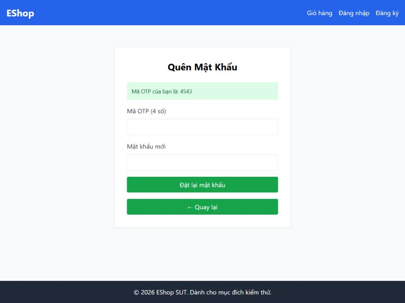
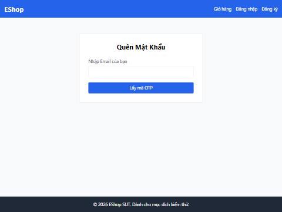
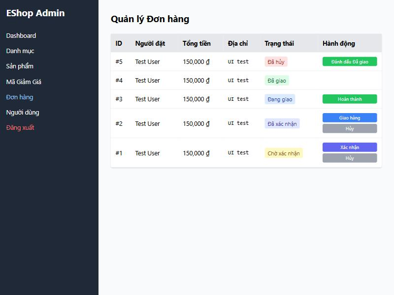
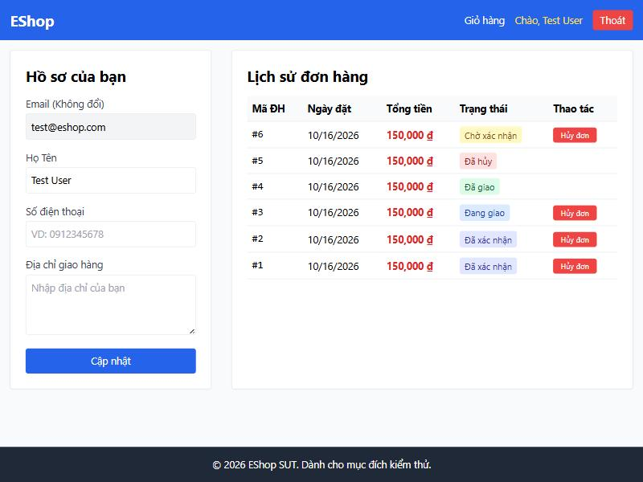
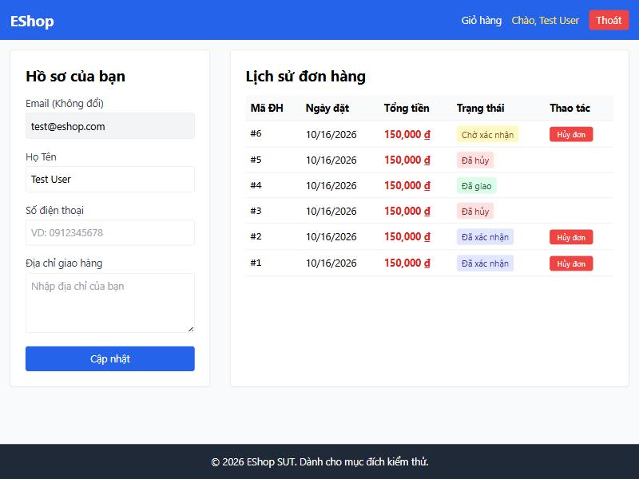
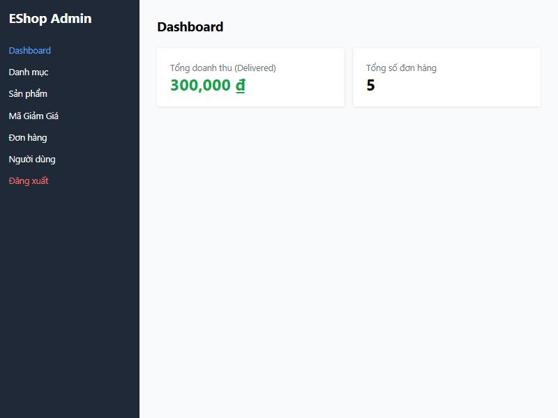
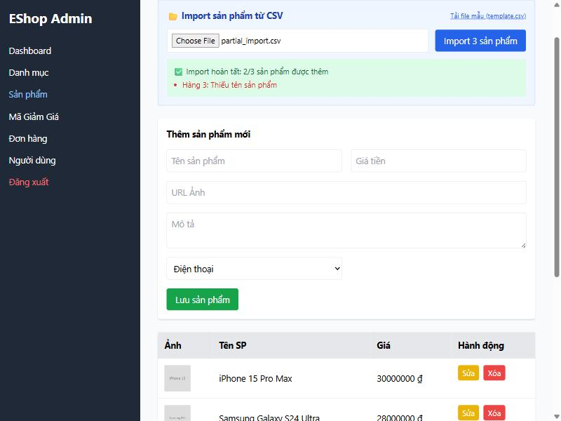
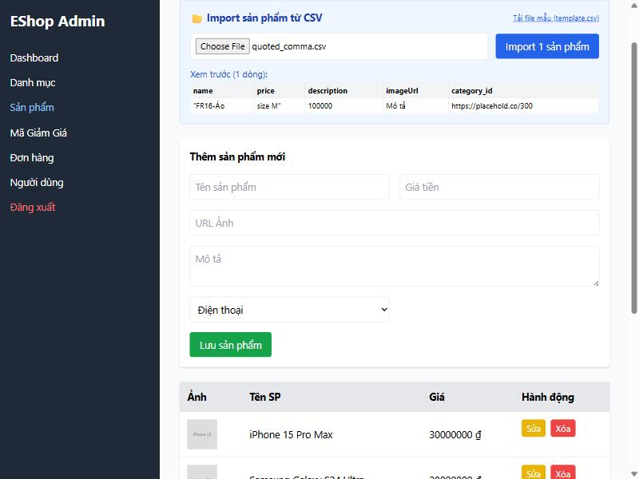
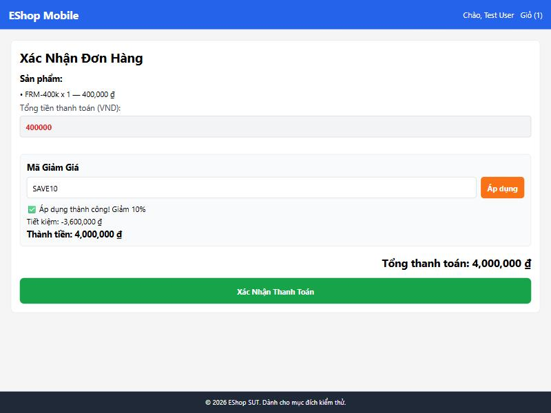

# BUG REPORT — HW02 Domain Testing on EShop (MSSV 23120231, Thành viên 4)

Tổng cộng **36 bug** (FR-03: 10, FR-10: 7, FR-16: 11, Mobile FR-08/09: 8), đã đăng trên GitHub Issues: https://github.com/nhaajtdajt/eshop-hw02-domain-testing/issues (#1–#36, nhãn `bug`, tiền tố tên feature trong tiêu đề). Mỗi bug có bước tái hiện, expected (trích SRS), actual, bằng chứng; screenshot được nhúng bên dưới và đính kèm trong issue.

## 1. FR-03 Quên & đặt lại mật khẩu (Pool A)

Môi trường chung: Windows 11, Node v22.20.0, Backend `http://localhost:3000`, Web `http://localhost:5173` (trình duyệt tích hợp Claude desktop, Chromium), dữ liệu seed gốc. Ngày phát hiện: 2026-10-16. Spec = `README.md` (SRS). Mức độ: Critical > Major > Minor.

Trạng thái GitHub Issues: **đã đăng** #1–#10 tại https://github.com/nhaajtdajt/eshop-hw02-domain-testing/issues (nhãn `bug`). Nội dung từng issue nằm trong `features/FR-03/issues/`.

| Bug | Tiêu đề | Mức độ | Test liên quan | Issue |
|---|---|---|---|---|
| BUG-01 | OTP được sinh ra chỉ có 4 chữ số thay vì 6 | Major | DT-01, BV-08 | #1 |
| BUG-02 | Form đặt lại mật khẩu từ chối mọi mật khẩu hợp lệ theo spec | Critical | DT-07, BV-10..BV-23 | #2 |
| BUG-03 | API reset-password chấp nhận mật khẩu rỗng/yếu (không validate phía server) | Major | DT-16..22, BV-09, BV-24, BV-25 | #3 |
| BUG-04 | Thiếu trường "Xác nhận mật khẩu mới" | Major | DT-23..25, BV-26..28 | #4 |
| BUG-05 | Thiếu Step Indicator "Bước x / 2" | Minor | DT-26, DT-27 | #5 |
| BUG-06 | Thiếu nút "Quay lại đăng nhập" | Minor | DT-28 | #6 |
| BUG-07 | Ô email dùng `type="text"` thay vì `type="email"` | Minor | DT-29 | #7 |
| BUG-08 | Trường bắt buộc không có ký hiệu `*` | Minor | DT-30 | #8 |
| BUG-09 | Lỗi hiển thị bằng `alert()`, không có vùng lỗi phía trên nút submit | Minor | DT-31 | #9 |
| BUG-10 | OTP không bao giờ hết hạn | Major | DT-15 | #10 |

---

##### BUG-01: OTP được sinh ra chỉ có 4 chữ số thay vì 6
- **Feature:** FR-03 (Pool A) — **Mức độ:** Major
- **Test liên quan:** FR03-DT-01, FR03-BV-08
- **Các bước tái hiện:**
  1. Mở `http://localhost:5173/forgot-password`.
  2. Nhập `test@eshop.com`, bấm "Lấy mã OTP".
  3. Quan sát mã OTP hiển thị và nhãn ô nhập OTP ở bước 2.
- **Expected (SRS FR-03, README.md dòng 51; SEC-07, dòng 284):** OTP gồm **6 chữ số** ngẫu nhiên, tối thiểu 6 chữ số.
- **Actual:** OTP chỉ có **4 chữ số** (ví dụ `4543`, `7523`; 20 lần gọi API cho giá trị từ 1001 đến 9316, độ dài luôn 4). Nhãn ô nhập ghi "Mã OTP (4 số)". Chỉ có 9000 giá trị khả dĩ.
- **Bằng chứng:** `evidence/step2_reset_form_ui.jpg`


, `evidence/api_results.json` (FR03-DT-01, FR03-BV-08). Vị trí code: `backend/server.js:72`, `frontend-web/src/pages/ForgotPassword.jsx:69`.

##### BUG-02: Form đặt lại mật khẩu từ chối mọi mật khẩu hợp lệ theo spec
- **Feature:** FR-03 — **Mức độ:** Critical (người dùng không thể đặt lại mật khẩu bằng mật khẩu đúng chuẩn)
- **Test liên quan:** FR03-DT-07, FR03-BV-10..BV-23
- **Các bước tái hiện:**
  1. Mở `/forgot-password`, nhập `test@eshop.com`, bấm "Lấy mã OTP".
  2. Nhập đúng OTP vừa hiển thị và mật khẩu mới `Newpass1!` (đủ 8 ký tự, hoa, thường, số, ký tự đặc biệt `!`).
  3. Bấm "Đặt lại mật khẩu".
  4. Lặp lại với `Ab1!wxyz`, `Newpass1@`, … (mọi ký tự trong `@$!%*?&`).
- **Expected (SRS FR-03 dòng 58 + FR-01 dòng 39):** Mật khẩu đáp ứng FR-01 được chấp nhận và đổi mật khẩu thành công.
- **Actual:** Hiện hộp thoại "Mật khẩu quá yếu! Phải dài tối thiểu 8 ký tự, gồm chữ hoa, chữ thường, số và KÝ TỰ ĐẶC BIỆT." với **mọi** mật khẩu hợp lệ. Regex phía client `/^(?=.*[a-z])(?=.*[A-Z])(?=.*\d)(?=.*\s)[A-Za-z\d\s]{8,}$/` đòi có khoảng trắng và chỉ cho phép `A-Za-z`, số, khoảng trắng nên cấm mọi ký tự đặc biệt. Chỉ mật khẩu **có khoảng trắng** mới qua (ví dụ `New pass1`), mâu thuẫn với chính thông báo lỗi.
- **Bằng chứng:** `evidence/ui_results.json` (mục `password_cases_ui_result`). Vị trí code: `frontend-web/src/pages/ForgotPassword.jsx:26`.

##### BUG-03: API reset-password chấp nhận mật khẩu rỗng/yếu (không validate phía server)
- **Feature:** FR-03 — **Mức độ:** Major (bypass ràng buộc bằng cách gọi API trực tiếp)
- **Test liên quan:** FR03-DT-16..DT-22, FR03-BV-09, BV-24, BV-25
- **Các bước tái hiện:**
  1. `curl -X POST localhost:3000/api/forgot-password -H "Content-Type: application/json" -d '{"email":"test@eshop.com"}'` → lấy `resetToken`.
  2. `curl -X POST localhost:3000/api/reset-password -H "Content-Type: application/json" -d '{"email":"test@eshop.com","resetToken":"<token>","newPassword":""}'`.
  3. Thử với `newPassword` = `Ab1!xyz`, `newpass1!`, `NEWPASS1!`, `Newpass!!`, `Newpass12`, `Newpass1#`.
- **Expected (SRS FR-03 dòng 58; FR-01 dòng 39):** Từ chối (HTTP 4xx), mật khẩu không đổi, vì mật khẩu mới phải tuân thủ FR-01.
- **Actual:** HTTP **200** "Password reset successfully"; mật khẩu bị đổi thành giá trị rỗng/yếu. Backend không kiểm tra độ mạnh.
- **Bằng chứng:** `evidence/api_results.json` (FR03-DT-16..22, BV-09, BV-24, BV-25). Vị trí code: `backend/server.js:87-98`.

##### BUG-04: Thiếu trường "Xác nhận mật khẩu mới"
- **Feature:** FR-03 — **Mức độ:** Major
- **Test liên quan:** FR03-DT-23..DT-25, FR03-BV-26..BV-28
- **Các bước tái hiện:** Mở `/forgot-password`, lấy OTP, quan sát form bước 2.
- **Expected (SRS FR-03 dòng 57, 59):** Có trường "Xác nhận mật khẩu mới"; hai trường mật khẩu phải khớp nhau.
- **Actual:** Chỉ có một ô "Mật khẩu mới" (và ô OTP). Không có xác nhận → người dùng gõ nhầm mật khẩu vẫn đổi được, không kiểm tra khớp.
- **Bằng chứng:** `evidence/step2_reset_form_ui.jpg`


. Code: `ForgotPassword.jsx:63-96`.

##### BUG-05: Thiếu Step Indicator "Bước x / 2"
- **Feature:** FR-03 — **Mức độ:** Minor
- **Test liên quan:** FR03-DT-26, FR03-DT-27
- **Các bước tái hiện:** Mở `/forgot-password` (bước 1), sau đó lấy OTP (bước 2); quan sát tiêu đề/form.
- **Expected (SRS FR-03 dòng 52; FR-22 dòng 256):** Hiển thị chỉ báo bước, ví dụ "Bước 1 / 2", "Bước 2 / 2".
- **Actual:** Không có chỉ báo bước ở cả hai bước.
- **Bằng chứng:** `evidence/step1_forgot_password_ui.jpg`


, `evidence/step2_reset_form_ui.jpg`


.

##### BUG-06: Thiếu nút "Quay lại đăng nhập"
- **Feature:** FR-03 — **Mức độ:** Minor
- **Test liên quan:** FR03-DT-28
- **Các bước tái hiện:** Mở `/forgot-password`; tìm nút quay về đăng nhập ở bước 1 và bước 2.
- **Expected (SRS FR-03 dòng 53):** Có nút "Quay lại đăng nhập".
- **Actual:** Bước 1 không có nút nào ngoài "Lấy mã OTP". Bước 2 chỉ có "← Quay lại" (trở về bước 1, không về đăng nhập), và nút này cùng màu xanh lá với nút chính.
- **Bằng chứng:** `evidence/step1_forgot_password_ui.jpg`


, `evidence/step2_reset_form_ui.jpg`


.

##### BUG-07: Ô email dùng `type="text"` thay vì `type="email"`
- **Feature:** FR-03 — **Mức độ:** Minor
- **Test liên quan:** FR03-DT-29 (liên quan DT-03)
- **Các bước tái hiện:** Mở `/forgot-password`, kiểm tra thuộc tính `type` của ô email (DevTools) hoặc nhập `testeshop.com` rồi gửi.
- **Expected (SRS FR-22 dòng 253):** Trường Email dùng `type="email"` (validate định dạng HTML5).
- **Actual:** `type="text"`; chuỗi sai định dạng vẫn được gửi lên server (server trả "User not found").
- **Bằng chứng:** `evidence/ui_results.json` (`step1_dom`). Code: `ForgotPassword.jsx:50`.

##### BUG-08: Trường bắt buộc không có ký hiệu `*`
- **Feature:** FR-03 — **Mức độ:** Minor
- **Test liên quan:** FR03-DT-30
- **Các bước tái hiện:** Mở `/forgot-password` và quan sát nhãn "Nhập Email của bạn", "Mã OTP", "Mật khẩu mới".
- **Expected (SRS FR-22 dòng 252):** Tất cả trường bắt buộc có `*` cạnh nhãn.
- **Actual:** Không nhãn nào có `*` (dù các ô đều `required`).
- **Bằng chứng:** `evidence/step1_forgot_password_ui.jpg`


, `evidence/step2_reset_form_ui.jpg`


.

##### BUG-09: Lỗi hiển thị bằng `alert()`, không có vùng lỗi phía trên nút submit
- **Feature:** FR-03 — **Mức độ:** Minor
- **Test liên quan:** FR03-DT-31
- **Các bước tái hiện:** Nhập email chưa đăng ký (`nobody@eshop.com`) và bấm "Lấy mã OTP"; hoặc nhập mật khẩu yếu ở bước 2.
- **Expected (SRS FR-22 dòng 255):** Thông báo lỗi xuất hiện **trên** nút submit trong trang.
- **Actual:** Lỗi hiện qua hộp thoại `alert()` của trình duyệt ("Lỗi: User not found", "Mật khẩu quá yếu!…", "Mã OTP không đúng…"); không có vùng lỗi trong form.
- **Bằng chứng:** `evidence/ui_results.json` (`step1_cases`, `otp_cases_ui_result`). Code: `ForgotPassword.jsx:20,28,37`.

##### BUG-10: OTP không bao giờ hết hạn
- **Feature:** FR-03 — **Mức độ:** Major
- **Test liên quan:** FR03-DT-15
- **Các bước tái hiện:**
  1. Gọi `POST /api/forgot-password` cho một tài khoản, lưu `resetToken`.
  2. Chờ 5,5 phút (không yêu cầu OTP mới).
  3. Gọi `POST /api/reset-password` với OTP đó.
- **Expected (SRS SEC-07, dòng 284):** OTP có thời hạn; OTP hết hạn bị từ chối. (SRS không nêu số phút cụ thể.)
- **Actual:** HTTP 200, mật khẩu bị đổi. Code không lưu thời điểm tạo OTP và không kiểm tra hết hạn, nên OTP hợp lệ vô thời hạn cho tới khi bị dùng hoặc bị thay.
- **Bằng chứng:** `evidence/expiry_run.log`, `evidence/api_results_expiry.json`. Code: bảng `users` (`database.js:50-61`) không có cột hết hạn; `server.js:87-98`.

---

#### Quan sát (không tính là bug của FR-03)
- Không giới hạn số lần đoán OTP: 300 lần đoán sai liên tiếp đều trả 400, không khóa (kết hợp BUG-01 → đoán OTP 4 chữ số trong vài giây). SRS không yêu cầu rate limit cụ thể nên ghi là quan sát.
- `forgot-password` trả 404 "User not found" → lộ email nào đã đăng ký.
- Email phân biệt hoa/thường (`TEST@ESHOP.COM` → 404); SRS không nêu.
- OTP sinh bằng `Math.random()`; mật khẩu lưu plaintext (thuộc SEC-01, ngoài FR-03).

## 2. FR-10 Máy trạng thái đơn hàng (Pool B)

Môi trường chung: Windows 11, Node v22.20.0, Backend `http://localhost:3000`, Web `http://localhost:5173`, Web Admin `http://localhost:5174` (Chromium trong Claude desktop), dữ liệu seed gốc. Ngày phát hiện: 2026-10-16. Spec = `README.md` (SRS). Mức độ: Critical > Major > Minor.
Tài khoản dùng: User `test@eshop.com` / `Test1234!`, Admin `admin@eshop.com` / `Admin123!` (từ `database.js`).

Trạng thái GitHub Issues: **đã đăng** #11–#17 (tiêu đề có tiền tố `[FR-10]`, nhãn `bug`) tại https://github.com/nhaajtdajt/eshop-hw02-domain-testing/issues. Nội dung từng issue nằm trong `features/FR-10/issues/`.

| Bug | Tiêu đề | Mức độ | Test liên quan | Issue |
|---|---|---|---|---|
| BUG-01 | API cho phép chuyển đơn đã hủy (`canceled`) sang `delivered` | Major | DT-24, DT-43 | #11 |
| BUG-02 | Web Admin hiện nút "Đánh dấu Đã giao" cho đơn đã hủy | Minor | DT-48 | #12 |
| BUG-03 | API cho phép User hủy đơn đang giao (`shipping`) | Major | DT-28 | #13 |
| BUG-04 | Trang Hồ sơ (Web) hiện nút "Hủy đơn" cho đơn đang giao | Major | DT-51 | #14 |
| BUG-05 | API đổi trạng thái đơn không kiểm tra quyền Admin | Critical | DT-33 | #15 |
| BUG-06 | Lỗi chuyển trạng thái không hợp lệ hiển thị tiếng Anh trên Web Admin | Minor | DT-54 | #16 |
| BUG-07 | Race condition: đơn đã hủy có thể bị xác nhận đè lại | Minor | X-01 | #17 |

---

##### BUG-01: API cho phép chuyển đơn đã hủy (`canceled`) sang `delivered`
- **Feature:** FR-10 (Pool B) — **Mức độ:** Major
- **Test liên quan:** FR10-DT-24, FR10-DT-43
- **Các bước tái hiện:**
  1. Đăng nhập Admin, lấy token. Đăng nhập User, tạo đơn bằng `POST /api/checkout` (`{"total_amount":100000,"shipping_address":"x"}`) → `orderId`.
  2. `PUT /api/admin/orders/<orderId>/status` với `{"status":"canceled"}` → 200.
  3. `PUT /api/admin/orders/<orderId>/status` với `{"status":"delivered"}`.
- **Expected (SRS FR-10, README.md dòng 160):** `canceled` là trạng thái kết thúc, không được chuyển sang trạng thái nào khác; chuyển không hợp lệ trả lỗi.
- **Actual:** HTTP **200** "Order status updated"; đơn từ `canceled` thành `delivered` (và được tính vào doanh thu Dashboard).
- **Bằng chứng:** `evidence/api_results.json` (FR10-DT-24, FR10-DT-43). Code: `backend/server.js:550-551` (nhánh `if (currentStatus === "canceled" && status === "delivered") isValidTransition = true`).

##### BUG-02: Web Admin hiện nút "Đánh dấu Đã giao" cho đơn đã hủy
- **Feature:** FR-10 — **Mức độ:** Minor (giao diện mời thao tác sai, hệ quả là BUG-01)
- **Test liên quan:** FR10-DT-48
- **Các bước tái hiện:**
  1. Có một đơn đã hủy (ví dụ hủy đơn từ trang Hồ sơ hoặc từ Admin).
  2. Đăng nhập Web Admin `http://localhost:5174`, mở tab "Đơn hàng".
  3. Quan sát cột "Hành động" của đơn có trạng thái "Đã hủy".
- **Expected (SRS FR-10, dòng 160; FR-18, dòng 221):** Đơn `canceled` là trạng thái kết thúc nên không có hành động chuyển trạng thái nào.
- **Actual:** Đơn "Đã hủy" có nút **"Đánh dấu Đã giao"**; bấm vào là chuyển được (xem BUG-01). Đơn "Đã giao" thì đúng là không có nút.
- **Bằng chứng:** `evidence/admin_orders_ui_states.jpg`


, `evidence/ui_results.json`. Code: `frontend-admin/src/App.jsx:862-869`.

##### BUG-03: API cho phép User hủy đơn đang giao (`shipping`)
- **Feature:** FR-10 — **Mức độ:** Major
- **Test liên quan:** FR10-DT-28
- **Các bước tái hiện:**
  1. User tạo đơn (`POST /api/checkout`), Admin chuyển lần lượt `confirmed` rồi `shipping`.
  2. Với token **User** (chủ đơn): `PUT /api/orders/<orderId>/cancel`.
- **Expected (SRS FR-10, dòng 161):** Khi đơn đã ở `shipping`, User không được phép tự hủy; chỉ Admin thao tác.
- **Actual:** HTTP **200** "Order canceled successfully"; đơn `shipping` thành `canceled`. Backend chỉ chặn `delivered` và `canceled`.
- **Bằng chứng:** `evidence/api_results.json` (FR10-DT-28). Code: `backend/server.js:329` (comment trong code cũng ghi "Lẽ ra phải là: if (order.status !== 'pending' && order.status !== 'confirmed')").

##### BUG-04: Trang Hồ sơ (Web) hiện nút "Hủy đơn" cho đơn đang giao
- **Feature:** FR-10 — **Mức độ:** Major (giao diện cho phép đúng thao tác bị cấm)
- **Test liên quan:** FR10-DT-51
- **Các bước tái hiện:**
  1. Đưa một đơn của `test@eshop.com` tới trạng thái `shipping` (qua Admin).
  2. Đăng nhập Web `http://localhost:5173` bằng `test@eshop.com`, mở `/profile`.
  3. Xem cột "Thao tác" của đơn "Đang giao" và bấm "Hủy đơn".
- **Expected (SRS FR-10, dòng 161; FR-20, dòng 236 cho Mobile cùng quy tắc):** Không hiển thị/không cho hủy khi `shipping`; chỉ hủy được ở `pending`/`confirmed`.
- **Actual:** Đơn "Đang giao" vẫn có nút "Hủy đơn"; bấm vào hiện "Hủy đơn thành công!" và đơn chuyển "Đã hủy" (kết hợp BUG-03). Các đơn `delivered`/`canceled` thì đúng là không có nút.
- **Bằng chứng:** `evidence/web_profile_orders_before.jpg`


 (đơn #3 "Đang giao" có nút), `evidence/web_profile_cancel_shipping_after.jpg`


 (đơn #3 sau khi bấm: "Đã hủy"), `evidence/ui_results.json`. Code: `frontend-web/src/pages/Profile.jsx:199-206` (điều kiện `status !== "delivered" && status !== "canceled"`).

##### BUG-05: API đổi trạng thái đơn không kiểm tra quyền Admin
- **Feature:** FR-10 (liên quan FR-12) — **Mức độ:** Critical (bất kỳ người dùng đăng nhập nào cũng điều khiển được vòng đời mọi đơn)
- **Test liên quan:** FR10-DT-33
- **Các bước tái hiện:**
  1. Đăng nhập User thường `test@eshop.com` lấy token (role `user`).
  2. `PUT /api/admin/orders/<orderId>/status` với header `Authorization: Bearer <token user>` và body `{"status":"confirmed"}` (đơn đang `pending`).
- **Expected (SRS FR-12, dòng 176–179; SEC-03, dòng 280; FR-10 "Admin xác nhận/giao hàng/hoàn tất"):** Từ chối (403) vì token không có `role = admin`; trạng thái đơn không đổi.
- **Actual:** HTTP **200** "Order status updated"; User thường xác nhận được đơn (và có thể giao/hoàn tất đơn của bất kỳ ai vì API không kiểm tra chủ đơn). Middleware `authenticateToken` chỉ kiểm tra token hợp lệ.
- **Bằng chứng:** `evidence/api_results.json` (FR10-DT-33). Code: `backend/server.js:100-110`, `:525`.

##### BUG-06: Lỗi chuyển trạng thái không hợp lệ hiển thị tiếng Anh trên Web Admin
- **Feature:** FR-10 (liên quan FR-21) — **Mức độ:** Minor
- **Test liên quan:** FR10-DT-54
- **Các bước tái hiện:**
  1. Mở Web Admin, tab "Đơn hàng", để một đơn `pending` hiển thị (nút "Xác nhận").
  2. Trước khi bấm, xác nhận đơn đó bằng API (hoặc ở tab khác) để trạng thái đã đổi nhưng trang chưa tải lại.
  3. Bấm "Xác nhận" trên trang cũ.
- **Expected (SRS FR-10 dòng 162; FR-21 dòng 244):** Thông báo lỗi phù hợp, bằng tiếng Việt, dễ hiểu.
- **Actual:** Hộp thoại "Lỗi: Invalid state transition from confirmed to confirmed" — tiếng Anh, chứa tên trạng thái kỹ thuật.
- **Bằng chứng:** `evidence/ui_results.json` (`admin_ui_stale_action_DT54`). Code: `frontend-admin/src/App.jsx:90-91`, `backend/server.js:555`.

##### BUG-07: Race condition — đơn đã hủy có thể bị xác nhận đè lại
- **Feature:** FR-10 — **Mức độ:** Minor (vi phạm bất biến nhưng chỉ xảy ra khi hai thao tác trùng thời điểm; quan sát 1/60 lần)
- **Test liên quan:** X-01 (test khám phá)
- **Các bước tái hiện:**
  1. Tạo đơn `pending`.
  2. Gửi **đồng thời** (cùng lúc) `PUT /api/admin/orders/<id>/status {"status":"confirmed"}` (Admin) và `PUT /api/orders/<id>/cancel` (User chủ đơn). Lặp lại nhiều lần (script `evidence/race_test.js` chạy 60 lần).
  3. Đọc trạng thái cuối.
- **Expected (SRS FR-10, dòng 160):** `canceled` là trạng thái kết thúc; sau khi bị hủy, không thể trở thành `confirmed`. Khi hai thao tác xung đột, một trong hai phải bị từ chối.
- **Actual:** Cả hai request đều trả 200 ở cả 60 lần; trạng thái cuối `canceled` 59 lần và `confirmed` **1 lần** (đơn đã hủy bị hồi sinh). Nguyên nhân: backend đọc trạng thái (`SELECT`) rồi ghi (`UPDATE ... WHERE id=?`) ở hai bước tách rời, không kiểm tra lại trạng thái cũ khi ghi.
- **Bằng chứng:** `evidence/race_result.json`, `evidence/race_test.js`. Code: `backend/server.js:321-342`, `:525-568`.

---

#### Quan sát ngoài phạm vi FR-10 (báo cho thành viên phụ trách; không tính vào số bug FR-10)
- **FR-13 (Dashboard):** "Tổng doanh thu (Delivered)" hiển thị 300,000 ₫ khi chỉ có một đơn đã giao 150,000 ₫ (nhân đôi, `frontend-admin/src/App.jsx:218`). Ảnh: `evidence/observation_dashboard_revenue.jpg`


.
- **FR-11 (Lịch sử đơn hàng):** `GET /api/orders/:id` không yêu cầu token, trả thông tin đơn của bất kỳ ai (HTTP 200 khi gọi không token).
- **FR-18 (Quản lý đơn Admin):** địa chỉ giao hàng render bằng `dangerouslySetInnerHTML` (`App.jsx:799-804`); chưa kiểm chứng XSS.
- Thông báo lỗi của API cho chuyển không hợp lệ là tiếng Anh ("Invalid state transition from X to Y"); chỉ tính lỗi khi hiển thị thẳng trên UI (BUG-06).

## 3. FR-16 Import sản phẩm từ CSV (Pool C)

Môi trường chung: Windows 11, Node v22.20.0, Backend `http://localhost:3000`, Web Admin `http://localhost:5174` (Chromium trong Claude desktop), dữ liệu seed gốc. Ngày phát hiện: 2026-10-16. Spec = `README.md` (SRS). Mức độ: Critical > Major > Minor.
Tài khoản: Admin `admin@eshop.com` / `Admin123!`, User `test@eshop.com` / `Test1234!` (từ `database.js`).
File CSV mẫu dùng trong các bước tái hiện có header `name,price,description,imageUrl,category_id`.

Trạng thái GitHub Issues: **đã đăng** #18–#28 (tiêu đề có tiền tố `[FR-16]`, nhãn `bug`) tại https://github.com/nhaajtdajt/eshop-hw02-domain-testing/issues. Nội dung từng issue nằm trong `features/FR-16/issues/`.

| Bug | Tiêu đề | Mức độ | Test liên quan | Issue |
|---|---|---|---|---|
| BUG-01 | Import không rollback: dòng hợp lệ vẫn được thêm khi file có dòng lỗi | Major | DT-25..29, DT-32, DT-33, BV-15..19 | #18 |
| BUG-02 | Không validate `price`: số âm, 0, chữ và rỗng đều được import | Major | DT-19..22 | #19 |
| BUG-03 | Parse CSV bằng `split(",")` làm hỏng trường có nháy kép/dấu phẩy | Major | DT-02, DT-03, DT-43 | #20 |
| BUG-04 | Chấp nhận file không phải `.csv` | Minor | DT-07, DT-08 | #21 |
| BUG-05 | Không kiểm tra header và số trường của dòng | Major | DT-12..15, BV-05, BV-06 | #22 |
| BUG-06 | API import nhận `name` toàn khoảng trắng | Minor | DT-18 | #23 |
| BUG-07 | Import bỏ qua ràng buộc danh mục và độ dài tên (FR-15) | Minor | DT-23, DT-24, BV-14 | #24 |
| BUG-08 | Báo cáo import gây hiểu nhầm: banner xanh "Import hoàn tất" dù có lỗi, API luôn trả HTTP 200 | Minor | DT-32, DT-33 (liên quan DT-16, 17) | #25 |
| BUG-09 | API import không kiểm tra quyền Admin | Critical | DT-35 | #26 |
| BUG-10 | Phần tử `null` trong `products` gây HTTP 500 lộ stack trace | Minor | DT-39 | #27 |
| BUG-11 | Import ~1000 dòng bị từ chối HTTP 413 do giới hạn body 100 KB, không có thông báo rõ ràng | Minor | BV-04 | #28 |

---

##### BUG-01: Import không rollback: dòng hợp lệ vẫn được thêm khi file có dòng lỗi
- **Feature:** FR-16 (Pool C) — **Mức độ:** Major
- **Test liên quan:** FR16-DT-25..DT-29, DT-32, DT-33, BV-15..BV-19
- **Các bước tái hiện:**
  1. Đăng nhập Web Admin `http://localhost:5174`, mở tab "Sản phẩm" (ghi số sản phẩm hiện có).
  2. Tạo file `partial.csv`:
     ```
     name,price,description,imageUrl,category_id
     FR16-1,100000,Mo ta,https://placehold.co/300,1
     ,100000,Mo ta,https://placehold.co/300,1
     FR16-3,100000,Mo ta,https://placehold.co/300,1
     ```
  3. Chọn file, bấm "Import 3 sản phẩm".
  4. Kiểm tra danh sách sản phẩm.
- **Expected (SRS FR-16, README.md dòng 210):** Có lỗi ở bất kỳ dòng nào thì toàn bộ import bị rollback (all-or-nothing); không sản phẩm nào được thêm.
- **Actual:** Dòng 1 và 3 được thêm; chỉ dòng 2 bị bỏ qua: "Import hoàn tất: 2/3 sản phẩm được thêm — Hàng 3: Thiếu tên sản phẩm". Cùng kết quả khi gọi API trực tiếp. Mỗi dòng được `INSERT` riêng, không có transaction.
- **Bằng chứng:** `evidence/ui_partial_import_green_banner.jpg`


, `evidence/api_results.json`, `evidence/ui_results.json`. Code: `backend/server.js:206-232`.

##### BUG-02: Không validate `price`: số âm, 0, chữ và rỗng đều được import
- **Feature:** FR-16 — **Mức độ:** Major
- **Test liên quan:** FR16-DT-19..DT-22
- **Các bước tái hiện:**
  1. File CSV một dòng dữ liệu có `price` lần lượt là `-1`, `0`, `abc` và để trống, ví dụ `FR16-1,-1,Mo ta,https://placehold.co/300,1`.
  2. Import trên Web Admin (hoặc `POST /api/admin/import-products` với `{"products":[{"name":"FR16-1","price":-1,"category_id":1}]}`).
  3. Kiểm tra danh sách sản phẩm.
- **Expected (SRS FR-16, dòng 208–209):** `price` phải là số dương; dòng sai bị từ chối (và theo rollback thì cả file không được import).
- **Actual:** Cả 4 trường hợp đều được thêm vào DB (`-1`, `0`, chữ `abc`; giá rỗng bị UI đổi thành 0). Backend chỉ kiểm tra `name`.
- **Bằng chứng:** `evidence/api_results.json` (FR16-DT-19..22), `evidence/ui_results.json`. Code: `backend/server.js:214-223`, `frontend-admin/src/App.jsx:392`.

##### BUG-03: Parse CSV bằng `split(",")` làm hỏng trường có nháy kép/dấu phẩy
- **Feature:** FR-16 — **Mức độ:** Major (dữ liệu bị lưu sai, tên và giá lệch cột)
- **Test liên quan:** FR16-DT-02, DT-03, DT-43
- **Các bước tái hiện:**
  1. File `quoted.csv`:
     ```
     name,price,description,imageUrl,category_id
     "FR16-Áo, size M",100000,Mo ta,https://placehold.co/300,1
     ```
  2. Chọn file trên Web Admin, xem bảng "Xem trước", rồi bấm Import.
  3. Mở danh sách sản phẩm và xem bản ghi vừa thêm.
  4. Lặp lại với tên `"FR16-Màn hình 27"" IPS"`.
- **Expected (SRS FR-16, dòng 206):** Hỗ trợ trường chứa dấu phẩy nếu được bọc trong dấu nháy kép (RFC 4180); nháy kép được escape bằng `""`.
- **Actual:** Dòng bị cắt tại dấu phẩy trong nháy kép nên các cột lệch: `name = "FR16-Áo` (còn dấu `"`), `price = size M"`, `description = 100000`. Với `""` thì tên lưu còn nguyên `"FR16-Màn hình 27"" IPS"`. Nháy kép không đóng cũng được chấp nhận.
- **Bằng chứng:** `evidence/ui_quoted_comma_preview.jpg`


, `evidence/ui_results.json`. Code: `frontend-admin/src/App.jsx:367-377` (`line.split(",")`).

##### BUG-04: Chấp nhận file không phải `.csv`
- **Feature:** FR-16 — **Mức độ:** Minor
- **Test liên quan:** FR16-DT-07, DT-08
- **Các bước tái hiện:** Đổi tên file CSV hợp lệ thành `products.txt` (hoặc `products.xlsx`) rồi chọn trong ô "Import sản phẩm từ CSV" và bấm Import.
- **Expected (SRS FR-16, dòng 204):** Đuôi file phải là `.csv`; file khác bị từ chối.
- **Actual:** File `.txt` và `.xlsx` vẫn được đọc và import (DB tăng). `<input type="file">` không có thuộc tính `accept` và code không kiểm tra tên file.
- **Bằng chứng:** `evidence/ui_results.json` (`file_input_accept_attribute: null`). Code: `frontend-admin/src/App.jsx:356-358`.

##### BUG-05: Không kiểm tra header và số trường của dòng
- **Feature:** FR-16 — **Mức độ:** Major
- **Test liên quan:** FR16-DT-12..DT-15, BV-05, BV-06
- **Các bước tái hiện:**
  1. Import file có header sai thứ tự `price,name,description,imageUrl,category_id`, hoặc thiếu cột `price`, thừa cột `sku`, hoặc viết hoa `Name,Price,...`.
  2. Import file có một dòng chỉ 4 trường, hoặc 6 trường.
- **Expected (SRS FR-16, dòng 205):** Dòng đầu phải là đúng `name,price,description,imageUrl,category_id`; file không đúng bị từ chối.
- **Actual:** Tất cả đều import thành công (DB tăng): header không được kiểm tra, cột thiếu cho giá trị rỗng/mặc định (`category_id` tự gán 1), cột thừa bị bỏ qua. Code còn chấp nhận các tên cột khác (`ten`, `gia`, `Name`, `Price`…).
- **Bằng chứng:** `evidence/ui_results.json` (DT-12..15, BV-05, BV-06). Code: `frontend-admin/src/App.jsx:368-402`.

##### BUG-06: API import nhận `name` toàn khoảng trắng
- **Feature:** FR-16 — **Mức độ:** Minor
- **Test liên quan:** FR16-DT-18
- **Các bước tái hiện:** `POST /api/admin/import-products` (token Admin) với `{"products":[{"name":"   ","price":100000,"category_id":1}]}`.
- **Expected (SRS FR-16, dòng 208):** `name` không được rỗng; tên chỉ gồm khoảng trắng không hợp lệ.
- **Actual:** HTTP 200, sản phẩm có tên `"   "` được thêm. (UI đã `trim()` trước khi gửi nên đã chặn; chỉ API bị lọt.)
- **Bằng chứng:** `evidence/api_results.json` (FR16-DT-18). Code: `backend/server.js:214`.

##### BUG-07: Import bỏ qua ràng buộc danh mục và độ dài tên (FR-15)
- **Feature:** FR-16 (liên quan FR-15) — **Mức độ:** Minor (theo diễn giải: FR-16 không nêu rõ)
- **Test liên quan:** FR16-DT-23, DT-24, BV-14
- **Các bước tái hiện:** Import dòng có `category_id = 999` (không tồn tại), hoặc để trống `category_id`, hoặc `name` dài 256 ký tự.
- **Expected (SRS FR-15, dòng 195–197):** Tên tối đa 255 ký tự; danh mục phải chọn từ danh sách có sẵn.
- **Actual:** Cả ba đều được thêm: danh mục không tồn tại vẫn lưu `999`, danh mục rỗng được tự gán `1`, tên 256 ký tự được chấp nhận.
- **Bằng chứng:** `evidence/api_results.json` (FR16-DT-23, DT-24, BV-14). Code: `backend/server.js:223` (`row.category_id || 1`).

##### BUG-08: Báo cáo import gây hiểu nhầm: banner xanh "Import hoàn tất" dù có lỗi, API luôn trả HTTP 200
- **Feature:** FR-16 — **Mức độ:** Minor
- **Test liên quan:** FR16-DT-32, DT-33 (và các test DT-16, DT-17, X-03 có cùng banner)
- **Các bước tái hiện:** Import file có một dòng thiếu tên (xem BUG-01) hoặc file phân cách bằng `;`; quan sát vùng thông báo dưới ô chọn file.
- **Expected (SRS FR-16, dòng 211):** Báo cáo rõ ràng: bao nhiêu dòng thành công, bao nhiêu dòng lỗi và lý do; khi có lỗi, import bị hủy toàn bộ và báo rõ như vậy.
- **Actual:** Banner xanh "✅ Import hoàn tất: 2/3 sản phẩm được thêm" kèm danh sách lỗi; không nêu **số** dòng lỗi và không báo import bị hủy. Với file chỉ có lỗi vẫn hiện "✅ Import hoàn tất: 0/1". API luôn trả HTTP 200.
- **Bằng chứng:** `evidence/ui_partial_import_green_banner.jpg`


, `evidence/api_results.json`, `evidence/ui_exploratory.json`. Code: `backend/server.js:234-240`, `frontend-admin/src/App.jsx:459-480`.

##### BUG-09: API import không kiểm tra quyền Admin
- **Feature:** FR-16 (liên quan FR-12) — **Mức độ:** Critical
- **Test liên quan:** FR16-DT-35
- **Các bước tái hiện:**
  1. Đăng nhập `test@eshop.com` (User thường) lấy token.
  2. `POST /api/admin/import-products` với header `Authorization: Bearer <token user>` và `{"products":[{"name":"FR16-1","price":100000,"category_id":1}]}`.
- **Expected (SRS FR-12, dòng 176–179; SEC-03, dòng 280):** Từ chối (403) vì token không có `role = admin`.
- **Actual:** HTTP 200, sản phẩm được thêm. `authenticateToken` chỉ kiểm tra token hợp lệ.
- **Bằng chứng:** `evidence/api_results.json` (FR16-DT-35). Code: `backend/server.js:199`.

##### BUG-10: Phần tử `null` trong `products` gây HTTP 500 lộ stack trace
- **Feature:** FR-16 — **Mức độ:** Minor
- **Test liên quan:** FR16-DT-39
- **Các bước tái hiện:** `POST /api/admin/import-products` (token Admin) với `{"products":[null]}`.
- **Expected:** 400 với thông báo lỗi rõ ràng; không để lộ chi tiết nội bộ (liên quan SEC).
- **Actual:** HTTP 500, trả trang HTML lỗi có stack trace, nêu `TypeError: Cannot read properties of null (reading 'name')` và đường dẫn tuyệt đối `...\backend\server.js:214:14`.
- **Bằng chứng:** `evidence/dt39_response.txt`. Code: `backend/server.js:213-216` (không kiểm tra từng phần tử).

##### BUG-11: Import ~1000 dòng bị từ chối HTTP 413 do giới hạn body 100 KB, không có thông báo rõ ràng
- **Feature:** FR-16 — **Mức độ:** Minor
- **Test liên quan:** FR16-BV-04
- **Các bước tái hiện:** `POST /api/admin/import-products` (token Admin) với 1000 sản phẩm (mỗi sản phẩm có mô tả ngắn, tổng ~131 KB). Với file CSV tương đương trên Web Admin, request gửi đi là cùng payload.
- **Expected (SRS FR-16, dòng 202):** Admin có thể import nhiều sản phẩm cùng lúc; nếu có giới hạn thì phải báo rõ ràng.
- **Actual:** HTTP **413** với trang HTML mặc định; DB không đổi. Giao diện chỉ hiển thị thông báo kỹ thuật của axios ("Request failed with status code 413", suy ra từ `App.jsx:412-414`, chưa quan sát trực tiếp trên UI). Giới hạn 100 KB là mặc định của `body-parser`, server không cấu hình lại.
- **Bằng chứng:** `evidence/api_results.json` (FR16-BV-04). Code: `backend/server.js:12` (`bodyParser.json()` không đặt `limit`).

---

#### Quan sát (không tính là bug của FR-16)
- File CSV phân cách bằng `;` (kiểu Excel tiếng Việt) không được nhận diện (X-03); dòng trống giữa file bị tính là dòng lỗi (X-02); BOM và khoảng trắng hai đầu được xử lý đúng (X-01, X-04).
- Chưa test: import trùng lặp (cùng file hai lần, trùng tên trong file) và giá có dấu phân cách hàng nghìn (`100.000`/`"100,000"`).

## 4. Mobile FR-08/09 Thanh toán & mã giảm giá trên Mobile (Pool D)

Môi trường chung: Windows 11, Node v22.20.0, Backend `http://localhost:3000`, ứng dụng Mobile chạy bằng **Expo Web** (`react-native-web`, Chromium trong Claude desktop; `API_URL` đổi tạm sang `localhost`), dữ liệu seed gốc. Ngày phát hiện: 2026-10-16. Spec = `README.md` (SRS). Mức độ: Critical > Major > Minor. **Chưa kiểm tra trên thiết bị thật/emulator.**
Tài khoản: User `test@eshop.com` / `Test1234!`, Admin `admin@eshop.com` / `Admin123!`.
Mã seed: `SAVE10` (percent 10, min 300,000, 1 lần), `BIGBUY` (fixed 50,000, min 500,000), `VIP100` (fixed 100,000, min 300,000, 2 lần), `EXPIRED`.
Ghi chú: BUG-01..06 nằm ở backend dùng chung với Web (FR-08/FR-09 của thành viên khác); báo ở đây kèm bằng chứng từ màn hình Mobile. Nên đối chiếu để tránh báo trùng khi nhóm tổng hợp.

Trạng thái GitHub Issues: **đã đăng** #29–#36 (tiêu đề có tiền tố `[Mobile FR-08/09]`, nhãn `bug`) tại https://github.com/nhaajtdajt/eshop-hw02-domain-testing/issues. Nội dung từng issue nằm trong `features/Mobile-FR-08-09/issues/`.

| Bug | Tiêu đề | Mức độ | Test liên quan | Issue |
|---|---|---|---|---|
| BUG-01 | Mã giảm theo % tính sai: tiền giảm âm, tổng thanh toán tăng | Critical | DT-09, 25, 27, 30; BV-03, 18, 19, 20 | #29 |
| BUG-02 | Tổng đơn đúng bằng ngưỡng tối thiểu bị từ chối (`>` thay vì `>=`) | Major | BV-02, BV-05 | #30 |
| BUG-03 | Checkout lưu nguyên `total_amount` của client, không kiểm tra giá trị | Critical | DT-07, 30, 32, 33, 34 | #31 |
| BUG-04 | Áp mã không cần đăng nhập và bỏ `user_id` là qua mặt kiểm tra lượt dùng | Major | DT-22, DT-24 | #32 |
| BUG-05 | Mã giảm cố định lớn hơn tổng đơn cho tổng thanh toán âm | Major | DT-26, BV-15 | #33 |
| BUG-06 | `coupon-usage` ghi lượt dùng cho mã không tồn tại | Minor | DT-36 | #34 |
| BUG-07 | Mobile bỏ mất sản phẩm cuối của giỏ khi gửi yêu cầu thanh toán | Major | DT-31, BV-22 | #35 |
| BUG-08 | Ô "Tổng tiền thanh toán" hiển thị số thô, không có `₫` và phân cách hàng nghìn | Minor | DT-27 | #36 |

---

##### BUG-01: Mã giảm theo % tính sai: tiền giảm âm, tổng thanh toán tăng
- **Feature:** Mobile FR-09 (dùng chung backend với Web FR-09) — **Mức độ:** Critical (mã giảm giá làm tăng giá đơn hàng lên 10 lần)
- **Test liên quan:** MFR-DT-09, DT-25, DT-27, DT-30; MFR-BV-03, BV-18, BV-19, BV-20
- **Các bước tái hiện:**
  1. Chạy ứng dụng Mobile, đăng nhập `test@eshop.com`, thêm một sản phẩm giá 400,000 ₫ vào giỏ, bấm "Tiến hành thanh toán".
  2. Nhập mã `SAVE10`, bấm "Áp dụng".
  3. (Tùy chọn) bấm "Xác Nhận Thanh Toán" rồi xem đơn trong lịch sử.
  - Cách gọi API: `POST /api/apply-coupon` với `{"code":"SAVE10","total_amount":400000,"user_id":2}`.
- **Expected (SRS FR-09, README.md dòng 124):** `percent`: `discount_amount = total × discount_value / 100` = 40,000; `final_amount` = 360,000.
- **Actual:** Màn hình hiện "Tiết kiệm: **-3,600,000 ₫**", "Thành tiền: **4,000,000 ₫**", "Tổng thanh toán: 4,000,000 ₫". API trả `discount_amount = -3600000`, `final_amount = 4000000`. Nếu xác nhận, đơn được lưu với tổng 4,000,000 ₫. Công thức trong code là `total × (1 − discount_value)` với `discount_value = 10`. Mã `percent` 100% cho `discount = -99,000` @1,000.
- **Bằng chứng:** `evidence/mobile_checkout_save10_negative_discount.jpg`


, `evidence/api_results.json`, `evidence/ui_results.json`. Code: `backend/server.js:399-401, 419-421`.

##### BUG-02: Tổng đơn đúng bằng ngưỡng tối thiểu bị từ chối (`>` thay vì `>=`)
- **Feature:** Mobile FR-09 (dùng chung backend) — **Mức độ:** Major
- **Test liên quan:** MFR-BV-02, MFR-BV-05
- **Các bước tái hiện:** Giỏ có tổng đúng 300,000 ₫ (sản phẩm giá 300,000 × 1), thanh toán, nhập `SAVE10`, bấm "Áp dụng" (hoặc `POST /api/apply-coupon` `{"code":"BIGBUY","total_amount":500000,"user_id":2}`).
- **Expected (SRS FR-09, dòng 118):** C3: tổng đơn **>=** `min_order_amount`; tổng 300,000 với `SAVE10` (min 300,000) phải được áp dụng.
- **Actual:** "Đơn hàng chưa đủ giá trị tối thiểu 300.000 ₫ để áp dụng mã này". Tương tự `BIGBUY` @500,000. Mã chỉ áp dụng được từ ngưỡng + 1 (300,001 / 500,001).
- **Bằng chứng:** `evidence/api_results.json` (MFR-BV-02, BV-05), `evidence/ui_results.json` (BV-02). Code: `backend/server.js:379` (`total_amount > coupon.min_order_amount`).

##### BUG-03: Checkout lưu nguyên `total_amount` của client, không kiểm tra giá trị
- **Feature:** Mobile FR-08 (dùng chung backend với Web FR-08) — **Mức độ:** Critical
- **Test liên quan:** MFR-DT-07, DT-30, DT-32, DT-33, DT-34
- **Các bước tái hiện:**
  1. Đăng nhập lấy token User.
  2. `POST /api/checkout` với `{"items":[{"id":1,"name":"iPhone 15 Pro Max","price":30000000,"quantity":1}],"total_amount":1}`.
  3. Lặp lại với `total_amount` bị thiếu, `-100`, `"abc"`.
  4. Xem đơn trong `GET /api/orders/my-orders`.
- **Expected (SRS FR-08, dòng 107):** Backend tự tính lại tổng tiền; không chấp nhận `total_amount` do client gửi lên (đơn phải có tổng 30,000,000 hoặc bị từ chối).
- **Actual:** HTTP 200 "Checkout successful"; đơn lưu `total_amount = 1`. Với thiếu/âm/chuỗi cũng tạo đơn thành công (đơn rác). Ứng dụng Mobile gửi `total_amount` do client tính (kể cả số sai của BUG-01: đơn #75 lưu 4,000,000 thay vì 360,000).
- **Bằng chứng:** `evidence/api_results.json` (DT-07, DT-32..34), `evidence/ui_results.json` (DT-30). Code: `backend/server.js:297-309`.

##### BUG-04: Áp mã không cần đăng nhập và bỏ `user_id` là qua mặt kiểm tra lượt dùng
- **Feature:** Mobile FR-09 (dùng chung backend) — **Mức độ:** Major
- **Test liên quan:** MFR-DT-22, MFR-DT-24
- **Các bước tái hiện:**
  1. `POST /api/apply-coupon` **không có** header `Authorization` với `{"code":"SAVE10","total_amount":400000}` → áp dụng thành công.
  2. Cho user đã dùng `SAVE10` một lần (đã thanh toán), gọi lại `apply-coupon` **không** gửi `user_id` (hoặc không token).
- **Expected (SRS FR-09, dòng 119–120; SEC-02, dòng 279):** C4: phải đăng nhập (JWT hợp lệ); C5: số lần đã dùng của user < `max_uses_per_user`.
- **Actual:** HTTP 200 trong cả hai trường hợp: endpoint không yêu cầu token; `user_id` do client tự gửi nên chỉ cần bỏ trường này là không còn bị kiểm tra lượt dùng.
- **Bằng chứng:** `evidence/api_results.json` (DT-22, DT-24). Code: `backend/server.js:363-433` (không có `authenticateToken`; kiểm tra lượt dùng chỉ khi `if (user_id)`).

##### BUG-05: Mã giảm cố định lớn hơn tổng đơn cho tổng thanh toán âm
- **Feature:** Mobile FR-09 (dùng chung backend) — **Mức độ:** Major (theo diễn giải: SRS không nêu, nhưng tổng thanh toán âm là bất hợp lý)
- **Test liên quan:** MFR-DT-26, MFR-BV-15
- **Các bước tái hiện:** Admin tạo mã `fixed` 100,000, min 0 (`POST /api/admin/coupons`); `POST /api/apply-coupon` với `total_amount = 99999`.
- **Expected (diễn giải theo FR-09, dòng 126):** `final_amount` không âm (tối đa giảm bằng tổng đơn, cho `final = 0`).
- **Actual:** `discount_amount = 100000`, `final_amount = -1` (với mã 1,000,000 @100,000: `final = -900,000`).
- **Bằng chứng:** `evidence/api_results.json` (MFR-DT-26, BV-15). Code: `backend/server.js:402-406`.

##### BUG-06: `coupon-usage` ghi lượt dùng cho mã không tồn tại
- **Feature:** Mobile FR-09 (dùng chung backend) — **Mức độ:** Minor
- **Test liên quan:** MFR-DT-36
- **Các bước tái hiện:** Với token User, `POST /api/coupon-usage` `{"coupon_id":99999}`.
- **Expected:** Từ chối (4xx) vì mã không tồn tại; không ghi bản ghi.
- **Actual:** HTTP 200 "Usage recorded"; bản ghi mới trong `coupon_usage` với `coupon_id = 99999`.
- **Bằng chứng:** `evidence/api_results.json` (MFR-DT-36). Code: `backend/server.js:444-454`.

##### BUG-07: Mobile bỏ mất sản phẩm cuối của giỏ khi gửi yêu cầu thanh toán
- **Feature:** Mobile FR-08 — **Mức độ:** Major (dữ liệu đơn hàng thiếu sản phẩm; hiện chưa lộ ra vì backend không dùng `items`)
- **Test liên quan:** MFR-DT-31, MFR-BV-22
- **Các bước tái hiện:**
  1. Đăng nhập; thêm vào giỏ `FRM-100k` và `FRM-200k` (hoặc hai sản phẩm bất kỳ).
  2. Mở giỏ, "Tiến hành thanh toán": màn hình liệt kê đủ 2 sản phẩm.
  3. Bấm "Xác Nhận Thanh Toán" và quan sát body request `POST /api/checkout` (ví dụ bằng DevTools Network).
- **Expected (SRS FR-08, dòng 106):** Giao diện/đơn hàng chứa đầy đủ sản phẩm đặt mua; request gửi đủ mọi sản phẩm trong giỏ.
- **Actual:** `items` chỉ có `FRM-100k`; sản phẩm cuối (`FRM-200k`) bị bỏ. Giỏ 3 sản phẩm gửi 2 sản phẩm; giỏ 1 sản phẩm gửi đủ 1. Mã nguồn dùng `items: cart.length > 1 ? cart.slice(0, -1) : cart`.
- **Bằng chứng:** `evidence/ui_results.json` (`BV-22_cart_with_2_items`, `DT-31_cart_with_3_items`). Code: `frontend-mobile/App.js:391`.

##### BUG-08: Ô "Tổng tiền thanh toán" hiển thị số thô, không có `₫` và phân cách hàng nghìn
- **Feature:** Mobile FR-08 (liên quan FR-21) — **Mức độ:** Minor
- **Test liên quan:** MFR-DT-27
- **Các bước tái hiện:** Thêm sản phẩm 400,000 ₫, vào màn "Xác Nhận Đơn Hàng", xem ô "Tổng tiền thanh toán (VND)".
- **Expected (SRS FR-21, dòng 246):** Luôn dùng ký hiệu `₫` với định dạng phân cách hàng nghìn.
- **Actual:** Ô hiển thị `400000`; các dòng khác ("Tổng thanh toán: 400,000 ₫") đúng định dạng.
- **Bằng chứng:** `evidence/mobile_checkout_save10_negative_discount.jpg`


, `evidence/ui_results.json`. Code: `frontend-mobile/App.js:684-690` (`value={String(cartTotal)}`).

---

#### Quan sát (không tính là bug của Mobile FR-08/09)
- Đơn tạo từ Mobile có `shipping_address = NULL` (Mobile không gửi địa chỉ); SRS không yêu cầu địa chỉ ở FR-08.
- Báo lỗi theo thứ tự "ngưỡng" trước "hết hạn" (mã hết hạn + đơn nhỏ báo "chưa đủ giá trị tối thiểu"); SRS không quy định thứ tự.
- `API_URL` trong `App.js` cứng là `http://192.168.10.13:3000/api`; phải sửa theo IP máy chủ khi chạy (SRS có ghi "IP LAN của máy chủ").
- Ngoài phạm vi, nên báo thành viên phụ trách: màn đăng nhập Mobile dùng nhãn "Username" (placeholder "Email") và nút "Sign In" tiếng Anh (FR-21/FR-02); ô số lượng trong giỏ cộng thêm 1 khi gõ (`App.js:615-623`, FR-20); nhãn "Tổng tạm tính" (FR-20).
- Chưa test: mất kết nối khi thanh toán, nhấn xác nhận thanh toán hai lần liên tiếp, thiết bị thật/emulator.
